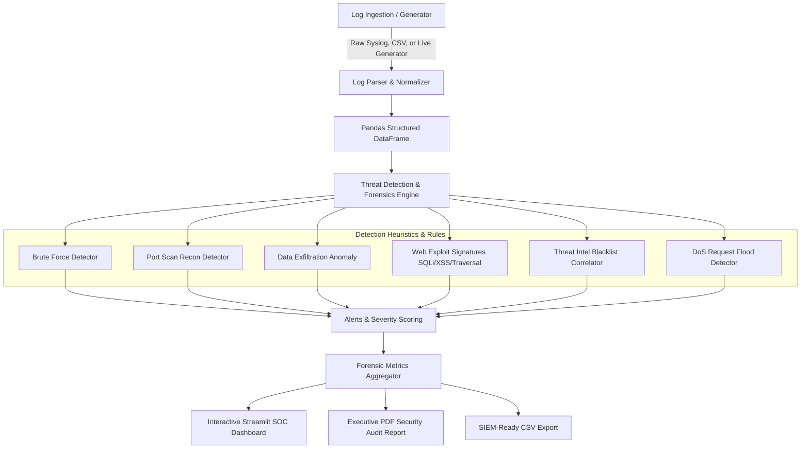

# Network Log Analyzer for Security Auditing
**Course:** Network Security & Forensics (NSF)  
**Project Type:** College Mini Project / SOC Defense Pipeline  
**Technology Stack:** Python 3.10+, Streamlit, Pandas, Plotly, ReportLab, Pytest  

---

## 📌 Project Overview
The **Network Log Analyzer for Security Auditing** is an automated Security Operations Center (SOC) log ingestion and digital forensics pipeline. It parses enterprise firewall, web server, and syslog records, detects active cyber threats (Brute Force, Port Scans, Data Exfiltration, Web Application Exploits, and DoS Floods) using rule-based heuristics and statistical anomaly detection, and provides an interactive SOC dashboard with one-click forensic audit report generation (PDF & CSV).

---

## 🏗️ Architecture & Data Flow



---

## 📁 Project Structure

```
NSF/
├── app.py                   # Streamlit SOC & Forensics Web Dashboard
├── analyzer.py              # Core Log Analysis, Parser & Threat Detection Engine
├── log_generator.py         # Multi-vector Synthetic Attack & Network Traffic Generator
├── report_generator.py      # PDF (ReportLab) & CSV Forensic Audit Report Generator
├── config.py                # Detection Thresholds, Port Map, Signatures & Threat Intel
├── requirements.txt         # Project Dependencies
├── README.md                # Comprehensive Documentation & Viva Q&A
├── sample_logs/             # Pre-generated Sample Datasets
│   ├── mixed_attacks.log    # Multi-attack test dataset (Syslog format)
│   ├── normal_traffic.log   # Legitimate background baseline
│   ├── network_events.csv   # Structured CSV dataset
│   └── security_audit_report.pdf # Sample generated executive audit PDF
└── tests/                   # Automated Unit Test Suite
    └── test_analyzer.py     # Pytest test cases for detection rules & parsers
```

---

## 🚀 Quick Setup & Execution Guide in Anti Gravity IDE

### 1. Prerequisites & Environment Setup
Open the built-in Terminal in Anti Gravity IDE (PowerShell / Command Prompt / Bash):

```bash
# 1. Install all dependencies
pip install -r requirements.txt
```

### 2. Launch the Interactive SOC Dashboard
```bash
streamlit run app.py
```
*The web dashboard will automatically open at `http://localhost:8501`.*

### 3. CLI Analysis & Sample Generator (Optional / Headless)
```bash
# Generate 250 sample records with attacks:
python log_generator.py --count 200 --output sample_logs/mixed_attacks.log

# Run command-line security audit:
python analyzer.py sample_logs/mixed_attacks.log

# Generate standalone PDF Audit Report:
python report_generator.py
```

### 4. Run Automated Test Suite
```bash
python -m pytest tests/test_analyzer.py -v
```

---

## 🎯 Cyber Attack Vectors Detected & Forensic Logic

| Attack Vector | Detection Methodology | Forensic Indicators | Severity |
| :--- | :--- | :--- | :--- |
| **SSH / Auth Brute Force** | Sliding time-window tracking failed authentications (`status_code` 401/403, `action` BLOCK) exceeding threshold (e.g. $\ge 4$ fails in 60s). | Attacker IP, repeated target port (22/3389/web), rapid fail intervals. | **HIGH** |
| **Port Scanning / Reconnaissance** | Tracking distinct destination ports contacted per source IP within sliding window (e.g. $\ge 5$ distinct ports in 60s). | Probed ports list, SYN probe packets, rapid port sequence. | **HIGH** |
| **Data Exfiltration / Anomaly** | Volumetric thresholding for single transfers (> 5 MB) and cumulative outbound transfer spikes (> 20 MB). | Huge byte count, outbound transfer to external untrusted destination. | **CRITICAL** |
| **Web Exploits (SQLi, XSS, Traversal, RCE)** | Regex signature inspection on HTTP message payloads for SQL statements, `<script>`, `../../etc/passwd`, command pipes. | Matched injection payload snippets, target web URI endpoints. | **CRITICAL / MEDIUM** |
| **Threat Intelligence Blacklist** | Cross-referencing source/destination IPs against known malicious feed (Tor exit nodes, Mirai botnets, C2 servers). | High-risk IOC reputation, geographic threat actor mapping. | **CRITICAL** |
| **Denial of Service (DoS Burst)** | High frequency request burst rate from single source IP (> 40 reqs in 30s). | Request flurry, 503 Service Unavailable, dropped packets. | **CRITICAL** |

---

## 🎓 College Viva / Examination Q&A (Network Security & Forensics)

### Q1: What is the difference between a Network Log and a Network Packet (PCAP)?
**Answer:**
- **Network Log:** A summarized text/metadata record created by network devices (firewalls, routers, web servers) documenting connection metadata such as timestamps, source/destination IPs, ports, protocol, bytes transferred, and action (ALLOW/BLOCK).
- **Packet Capture (PCAP):** Full raw capture of every packet on the wire, including full layer headers and raw payloads. Logs are lightweight and ideal for high-throughput security auditing, while PCAPs are used for deep packet payload inspection.

### Q2: How does sliding-window analysis work for Brute Force detection?
**Answer:**
Instead of counting failed attempts across an entire day, a sliding window groups log entries within a specific rolling duration $\Delta t$ (e.g., 60 seconds). For every incoming failed login at time $T$, the engine queries all failed events in interval $[T, T + \Delta t]$. If the count exceeds the threshold $N$, a Brute Force Alert is raised.

### Q3: Why is Port Scanning considered a precursor to an advanced cyber attack?
**Answer:**
Port scanning is the active reconnaissance phase of the Cyber Kill Chain. Attackers scan ports to map out listening network services, identify outdated daemon versions (e.g., Apache, OpenSSH, MySQL), and locate vulnerable attack surfaces before launching targeted exploits.

### Q4: What are Indicators of Compromise (IOCs)?
**Answer:**
IOCs are forensic artifacts observed on a network or operating system that indicate with high confidence that an intrusion or policy breach has occurred. Examples include known malicious IP addresses, unusual outbound data spikes, specific attack strings in log messages, and abnormal port connection attempts.

### Q5: How does this project assist in digital forensics and incident response?
**Answer:**
1. **Identification:** Ingests and parses disparate network logs.
2. **Analysis & Containment:** Flags threat actors, isolates malicious IPs, and calculates network risk score.
3. **Documentation & Reporting:** Generates timestamped, non-repudiable PDF and CSV audit reports aligned with NIST SP 800-61 guidelines.
